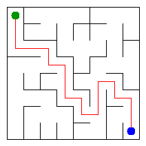

# Assignment 3. Maze Escape

Student ID: 251628
Name: Magzhan
Group: SE-2540
Maze size (rows x columns): 8 x 8

This file is the report. Fill it in as you go. How to start: `START_HERE.md`. The task: `docs/Assignment3.pdf`.

## Program output

The 13 lines your program prints on your data (`java -cp out Main`):

    Broken: 63
    Kept: 49
    Last broken wall: 97
    MST cost: 20795
    Heaviest broken wall: 666
    Path length: 18
    DFS visited: 43
    Dead ends: 20
    Zones: 10
    Largest zone: 11
    Is DAG: 0
    Flow stages: 6
    Fastest route cost: 8

My maze:

## Questions

Answer in your own words, two or three sentences each.

Mission 0. What do find and union do, and what makes them fast in your code?
find goes through cells to find root and returns it. union find two roots and if they have different size it will put smaller into the larger one. Else first root becomes parent of second root. Code process fast by using size inside union and by path compressing inside find.

Mission 1. Why is Broken always R*C - 1, and Kept always (R-1)*(C-1)?
Because every broken wall joins two different groups so number of groups goes down by -1. We start from R*C and end with one group, so R*C-1 walls are broken. There are R(C-1) + (R-1)C inner walls in total, and R(C-1) + (R-1)C - (RC-1) = (R-1)(C-1) walls stay.

Mission 2. My MST cost from Kruskal and from Prim, and why they are equal:
Both give 20795. All wall costs are different, so there is only one minimum spanning tree, and both algorithms find it. They do same work but by different ways. They both finds cheapest wall without cycle, difference in order.

Mission 3. Why is there exactly one path between two cells? How did you avoid a stack overflow on a huge maze?
In Mission 1 a wall is broken only when its two cells are not connected yet, so no cycle is made. Connected graph without cycles is a tree, and tree has only one path between any two cells. DFS uses array as stack so long path doesn't throw stack overflow

Mission 4. Why does the second pass of Kosaraju go on the reversed graph? Why do the slides have no cycle exactly when Zones equals the number of cells?
The cell which finishes last in the first pass is in a "top" zone. On reversed slides you can't leave this zone or go to others. So DFS collects one zone and didnt go to others. If cycle inside all cells inside one zone, so zones less than cells. If no cycle inside no one cell can go back to itself so every cell is inside its own zone

Mission 5. Why is it enough to go through the zones in the order of their numbers? What does this pass cost?
Kosaraju numbers zones in topological order: every slide between zones goes from smaller number to a larger one. So when we reach zone X all zones that can lead to X is already done, and values are final. The pass looks at every cell and slides once, so it costs O(n+m).

## AI use
I used Claude (Anthropic) to explain DSU, Kruskal, Prim, DFS, Kosaraju and shortest paths in a DAG, to give me code skeletons that I completed, to find errors in my code, and to help me phrase the README answers in English. I checked every part with tools/Check.java and can explain every line.

## Timing (Mission 7)

Milliseconds, 5 runs each, from `java -cp out Bench`.

| maze | Kruskal | Prim |
|---|---|---|
| 100 x 100 |14|17|
| 300 x 300 |62|172|
| 1000 x 1000 |1271|4192|

What do the numbers say about how the time grows? Two or three sentences.
The cell count increases by a factor of 11 between 300x300 and 1000x1000, while the running time for Kruskal increases by a factor of 20 and for Prim a factor of 24, and both comply with O(m log m). Prim takes 3 times longer than Kruskal since each wall gets put in the heap twice, and many walls get removed just to be ignored. The timings for 100x100 map are too low to be compared.

## Complexity

n is the number of cells, m the number of walls (or slides). Fill in every algorithm you wrote.

| algorithm | time | space | assumptions |
|---|---|---|---|
| DSU find and union |O(α(n))|O(n)|union by size and path compression|
| Kruskal |O(m log m)|O(n + m)|sorting the walls is the slowest part|
| Prim |O(m log m)|O(n + m)|binary heap (PriorityQueue); a wall can be added to the heap twice|
| DFS |O(n + m)|O(n)|own array stack, no recursion|
| Kosaraju |O(n + m)|O(n + m)|two DFS passes, slide lists from Graphs|
| Route in the zone graph |O(n + m)|O(n + m)|zones go in topological order, no priority queue|

## Before you submit

- data/walls.txt, data/slides.txt and output/maze.png are in the repository.
- `java tools/Check.java` shows all examples right.
- This README is filled in, the program output and the section AI use included.
- The work is pushed to main (at least one commit per mission) and the repository is public.
- The link is attached in Moodle.
